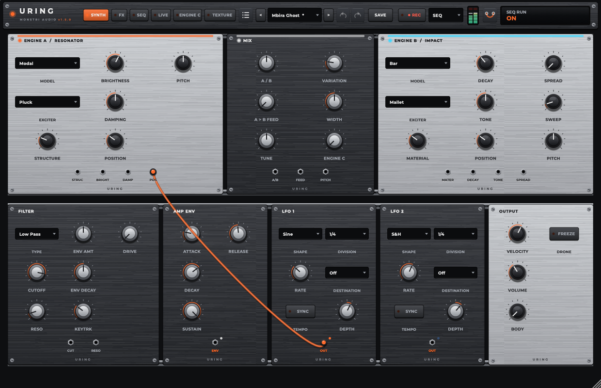
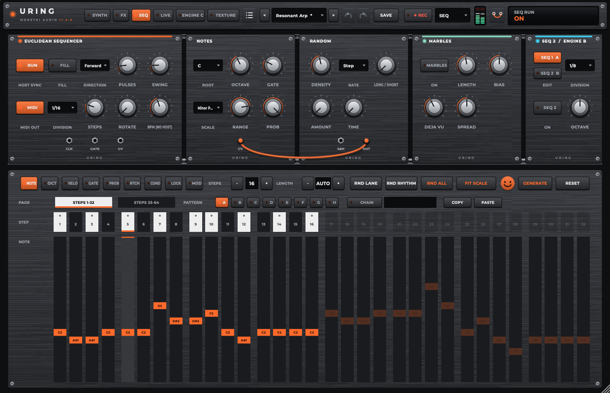
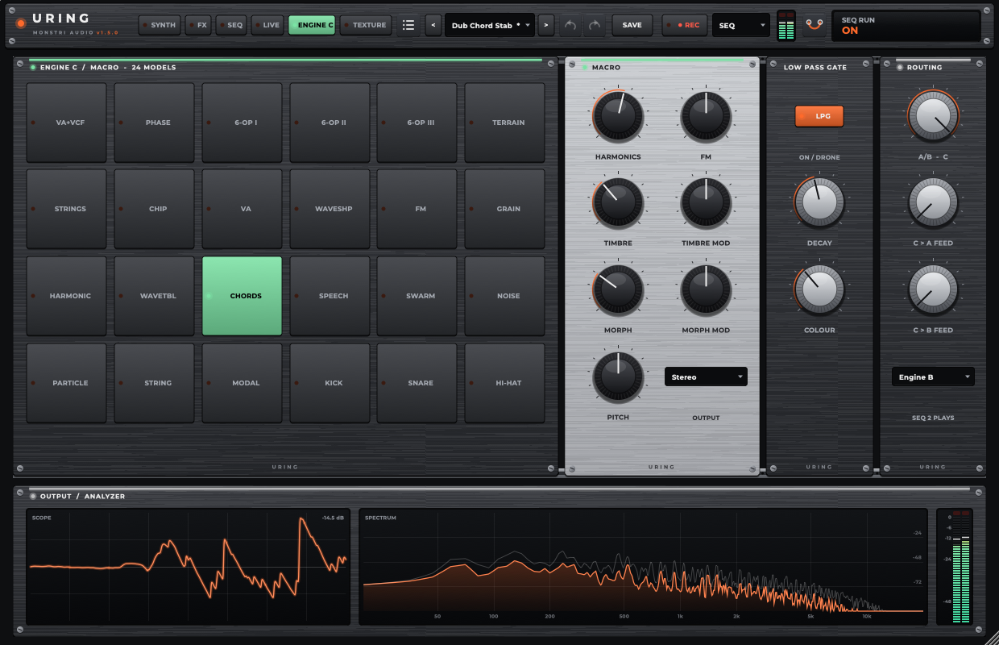
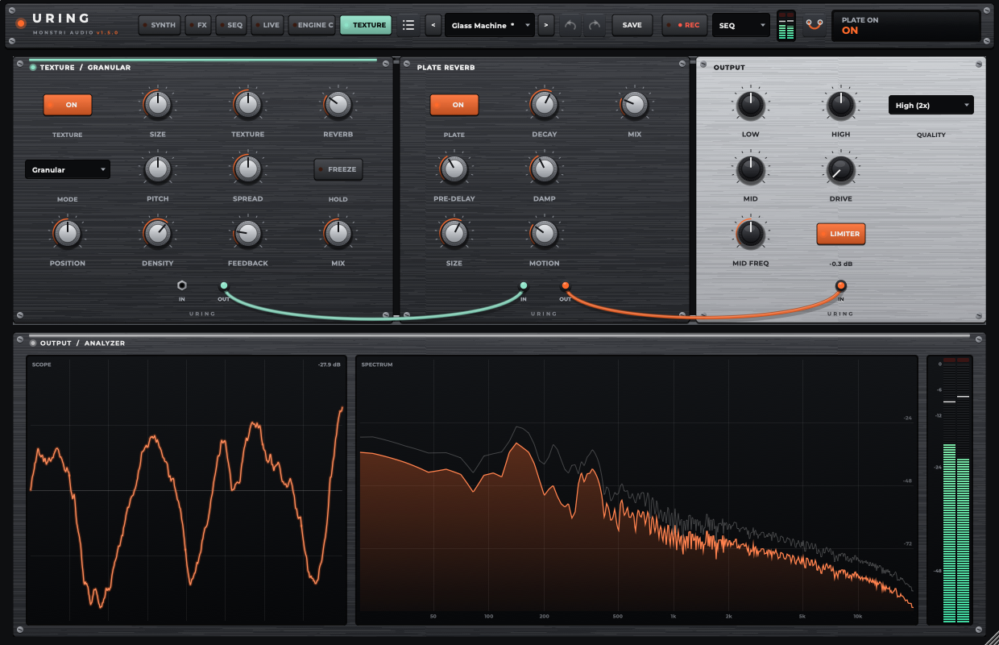

# URing

**Sintetizador de modelado físico, gratis y de código libre** — por Monstri Audio.
*[Read in English](README.md)*



Tres motores que se pueden mezclar y conectar entre sí:

- **A · Resonator:** cuerdas, modal, piano, tine, reed, resonancia simpática.
- **B · Impact:** membranas, barras, placas, campanas, marimba, vibráfono, mbira, steel pan, gong.
- **C · Macro:** 24 modelos de síntesis (VA, FM, wavetable, acordes, granular, percusión…).

Además:

- **7 filtros:** pasa-bajos, pasa-banda, pasa-altos, notch, **ladder 24 dB**, **comb** (tubos y metales) y **formant** (vocales A-E-I-O-U).
- **Página TEXTURE:** procesador **granular** basado en Clouds (granular, stretch, looping delay y espectral, con FREEZE), **plate reverb** y salida con **EQ de 3 bandas, drive y limitador** (nunca pasa de −0,3 dBFS).
- **Dos secuenciadores euclidianos** con polimetría, locks por paso, mutación y modo **MARBLES** (melodías aleatorias que se repiten o evolucionan con DÉJÀ VU).
- **Calidad HIGH** (oversampling x2: sin aliasing con drive y notas agudas) o **ECO** para máquinas lentas.
- Grabación de movimientos (REC), pad X/Y, página LIVE con morph y macros, glitch, tape delay, spring reverb, MIDI learn, deshacer/rehacer.
- **165 presets** con el volumen igualado: bajos, pads, teclados, percusión, drones, texturas y secuencias.
- Interfaz en **inglés o español** (tocá el logo → IDIOMA).

Novedades de la **1.5**: carril **MOD** en el secuenciador (otro modelo del motor C en cada paso: una batería entera desde un solo secuenciador), **motor C como excitador** del resonador A y **C > B FEED**, cables que se pueden **mostrar, hacer transparentes u ocultar** (el mouse sobre un jack muestra lo conectado), **ESCUCHAR** en el buscador de presets, y el secuenciador siempre arranca **apagado** hasta que tocás RUN.

| Secuenciador | Motor C (Macro) | Texture |
|---|---|---|
|  |  |  |

## Descargar e instalar

Bajá la última versión en **Releases** (a la derecha de esta página).

- **Mac (Intel y Apple Silicon, macOS 11 o superior):** abrí `URing-<versión>-Mac.pkg`.
  URing no está firmado por Apple (es un proyecto gratuito), así que la primera vez macOS lo
  bloquea: andá a *Ajustes del Sistema → Privacidad y seguridad → "Abrir igualmente"*, o hacé
  clic derecho sobre el .pkg → *Abrir*. Si el plugin no aparece en tu DAW, ejecutá
  `Permitir URing.command` (incluido en el zip).
- **Windows 10/11 (64 bits):** descomprimí `URing-<versión>-Windows.zip` y ejecutá
  `INSTALAR_PLUGIN.bat` como administrador.

Después, en tu DAW: re-escaneá los plug-ins. Manuales: [`docs/URing_Manual_ES.pdf`](docs/URing_Manual_ES.pdf) (español)
y [`docs/URing_Manual_EN.pdf`](docs/URing_Manual_EN.pdf) (inglés).

## Apoyar el proyecto ♥

URing es y va a seguir siendo gratis. Si lo usás en tu música y querés ayudar a que siga creciendo:

- **PayPal:** [paypal.me/JavierCazou](https://paypal.me/JavierCazou)
- **Desde Argentina (Cafecito / Mercado Pago):** _(próximamente)_

También ayuda mucho compartir lo que hagas con URing, reportar errores en **Issues** y
proponer mejoras.

## Compilar desde el código

Requisitos: CMake 3.22+, y Xcode (Mac) o Visual Studio 2022 (Windows). JUCE 8 se descarga solo.

```bash
./install.sh                    # Mac: compila e instala en ~/Library/Audio/Plug-Ins
./package_mac.sh                # Mac: instalador .pkg universal + zip para compartir (en dist/)
./package_mac.sh --intel        # Mac: solo Intel (más rápido)
```

En GitHub, cada push a `main` compila automáticamente Mac y Windows
(*Actions → Build → Artifacts*). Al crear un tag `v1.3.0` se publica una Release con los instaladores.

## Licencia

URing es software libre bajo la **GNU Affero General Public License v3.0** (ver `LICENSE`).
Podés usarlo para hacer música (incluso comercial), compartirlo y modificarlo; si distribuís
una versión modificada, tiene que seguir siendo libre bajo la misma licencia.

Los sonidos que hagas con URing son tuyos: la licencia cubre el programa, no tu música.

## Créditos

Ver [`CREDITOS.md`](CREDITOS.md). En resumen: el motor C, la página TEXTURE y el modo MARBLES
usan el código de **Plaits**, **Clouds** y **Marbles** de Mutable Instruments (Émilie Gillet, licencia MIT),
la interfaz usa **JUCE** (AGPLv3) y la tipografía **Montserrat** (SIL OFL).

URing es un proyecto independiente; no está afiliado ni respaldado por Mutable Instruments
ni por ninguna otra marca mencionada.
