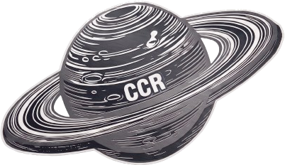
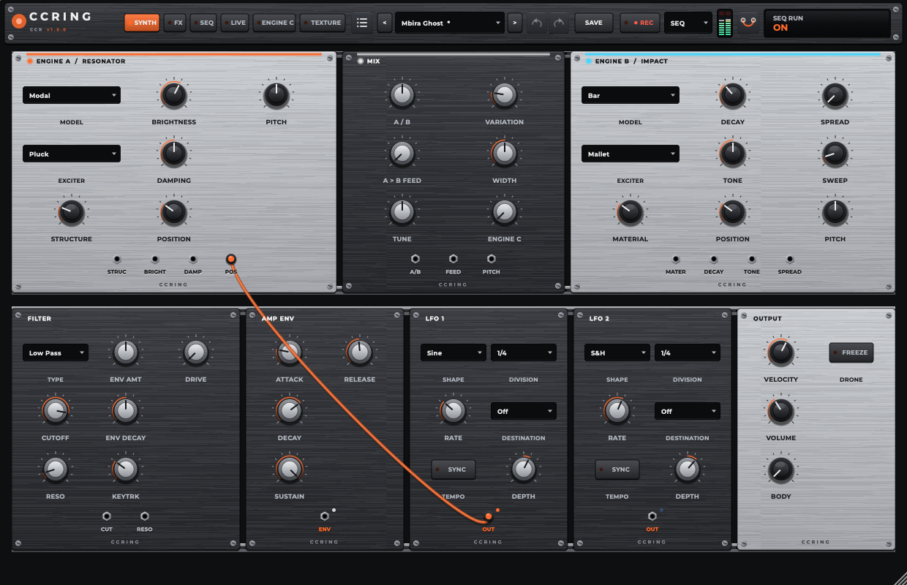
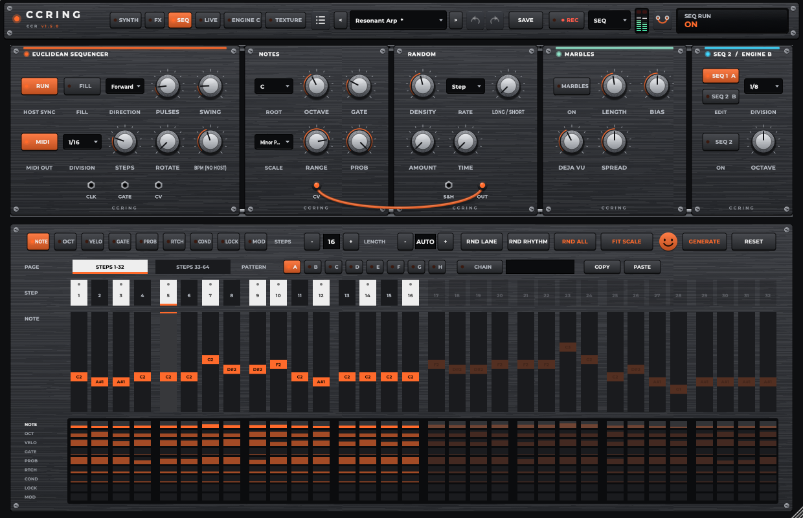
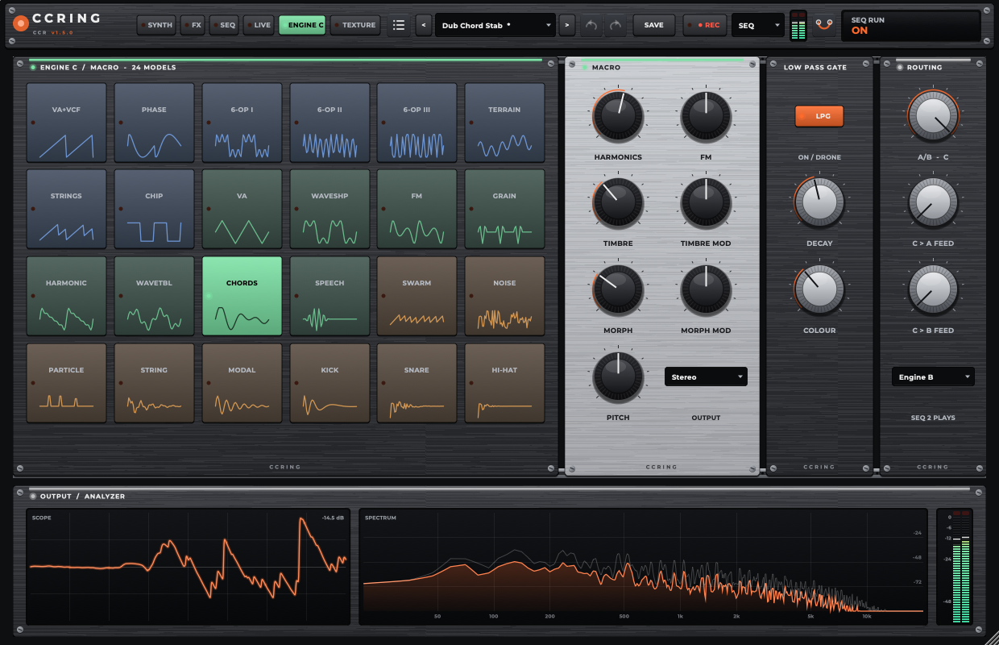
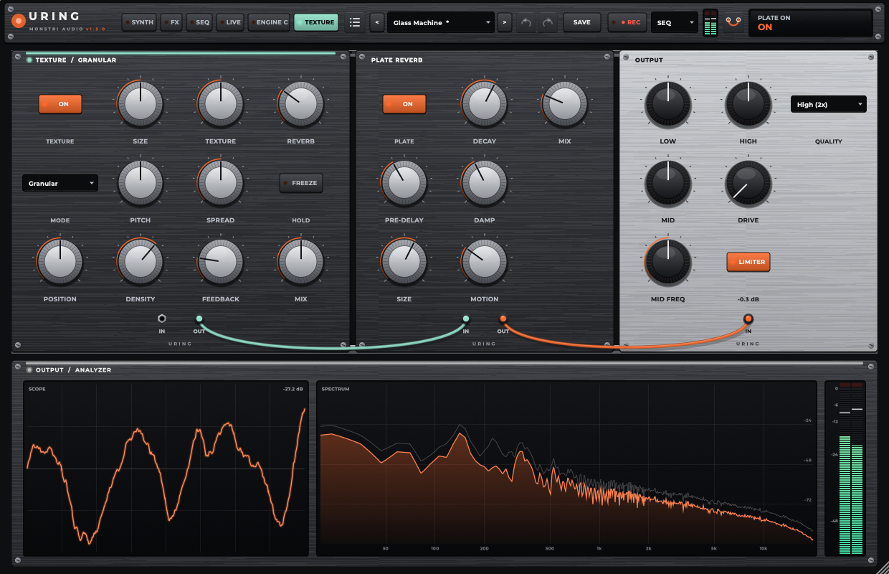

<p align="center"></p>

# CCRing

**Free and open-source physical-modelling synth with granular texture** — by CCR.
VST3 / Audio Unit / CLAP / Standalone for macOS (Intel and Apple Silicon) and Windows.

*[Leer en español](README.es.md)*



Three engines you can mix and patch into each other:

- **A · Resonator:** strings, modal, piano, tine, reed, sympathetic resonance.
- **B · Impact:** membranes, bars, plates, bells, marimba, vibraphone, mbira, steel pan, gong.
- **C · Macro:** 24 synthesis models (VA, FM, wavetable, chords, granular, percussion…).

Plus:

- **7 filters:** low-pass, band-pass, high-pass, notch, **ladder 24 dB**, **comb** (tubes and metals) and **formant** (vowels A-E-I-O-U).
- **TEXTURE page:** a **granular** processor based on Clouds (granular, stretch, looping delay and spectral, with FREEZE), a **plate reverb** and an output stage with **3-band EQ, drive and limiter** (never goes above −0.3 dBFS).
- **Two Euclidean sequencers** with polymeter, per-step locks, mutation and **MARBLES** mode (random melodies that repeat or evolve with DÉJÀ VU).
- **HIGH quality** (2x oversampling: no aliasing with drive and high notes) or **ECO** for slower computers.
- Motion recording (REC), X/Y pad, LIVE page with morph and macros, glitch, tape delay, spring reverb, MIDI learn, undo/redo.
- **165 presets** with matched loudness: basses, pads, keys, percussion, drones, textures and sequences.
- Interface in **English or Spanish** (click the logo → LANGUAGE).

New in **1.5**: a **dice** button (level-matched random sounds, or a new sound on every note), a **MOD lane** in the sequencer (a different engine C model on every step — a whole kit from one sequencer), **engine C as the exciter** of resonator A and **C > B feed**, cables that can be **shown, faded or hidden** (hover a jack to see what is patched), **PREVIEW** in the preset browser, and the sequencer always starts **off** until you press RUN.

| Sequencer | Engine C (Macro) | Texture |
|---|---|---|
|  |  |  |

## Download and install

Get the latest version from **Releases** (right-hand side of this page).

- **Mac (Intel and Apple Silicon, macOS 11 or later):** open `CCRing-<version>-Mac.pkg`.
  CCRing is not signed by Apple (it is a free project), so the first time macOS blocks it:
  go to *System Settings → Privacy & Security → "Open Anyway"*, or right-click the .pkg → *Open*.
  If the plug-in does not show up in your DAW, run `Allow CCRing.command` (included in the zip).
- **Windows 10/11 (64-bit):** unzip `CCRing-<version>-Windows.zip` and run `INSTALAR_PLUGIN.bat` as administrator.

Then rescan plug-ins in your DAW. Manuals: [`docs/CCRing_Manual_EN.pdf`](docs/CCRing_Manual_EN.pdf) (English)
and [`docs/CCRing_Manual_ES.pdf`](docs/CCRing_Manual_ES.pdf) (Spanish).

## Support the project ♥

CCRing is and will stay free. If you use it in your music and want to help it grow:

- **PayPal:** [paypal.me/JavierCazou](https://paypal.me/JavierCazou)
- **Mercado Pago (Argentina):** alias **`nodrama.perro`**

Sharing what you make with CCRing, reporting bugs in **Issues** and suggesting improvements helps a lot too.

## Building from source

Requirements: CMake 3.22+, and Xcode (Mac) or Visual Studio 2022 (Windows). JUCE 8 is downloaded automatically.

```bash
./install.sh                    # Mac: build and install into ~/Library/Audio/Plug-Ins
./package_mac.sh                # Mac: universal .pkg installer + shareable zip (in dist/)
./package_mac.sh --intel        # Mac: Intel only (faster)
```

On GitHub, every push to `main` builds Mac and Windows automatically (*Actions → Build → Artifacts*).
Pushing a tag such as `v1.5.0` publishes a Release with both installers.

## Licence

CCRing is free software under the **GNU Affero General Public License v3.0** (see `LICENSE`).
You can use it to make music (commercial music too), share it and modify it; if you distribute
a modified version, it must stay free under the same licence.

The sounds you make with CCRing are yours: the licence covers the program, not your music.

## Credits

See [`CREDITOS.md`](CREDITOS.md). In short: engine C, the TEXTURE page and MARBLES mode use the
code of **Plaits**, **Clouds** and **Marbles** by Mutable Instruments (Émilie Gillet, MIT licence),
the interface uses **JUCE** (AGPLv3) and the **Montserrat** typeface (SIL OFL).

CCRing is an independent project; it is not affiliated with or endorsed by Mutable Instruments
or any other brand mentioned.
